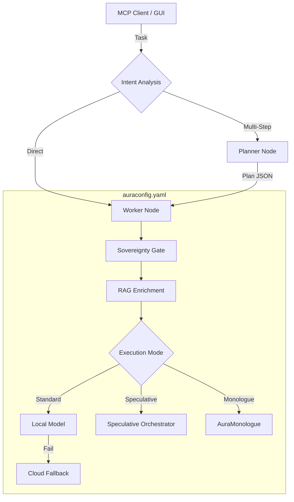
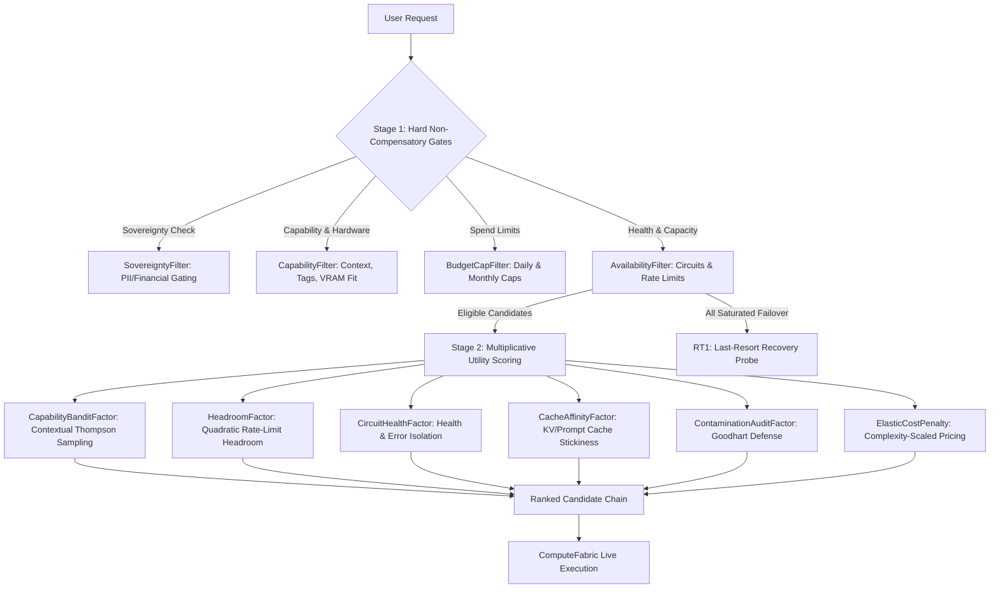

# AuraRouter: The Intelligent Routing Fabric

**Current Status:** Production Prototype v0.5.8 (Nov 2026)  
**Maintainer:** Steven Siebert / AuraCore Dynamics

## Overview

AuraRouter is a smart routing layer for Large Language Models (LLMs). It acts as middleware that directs your prompts to the best available model—whether that's a fast local model running on your laptop or a powerful cloud model. 

AuraRouter handles the logistics of AI: it classifies your task, plans the execution, and selects the most cost-effective and secure model for the job. It can run as an MCP server for IDEs, a desktop application with a built-in dashboard, or a managed service on a distributed grid.

### Why AuraRouter? (The FMoE Approach)

Traditional AI setups usually send every prompt to a single, large model. This is often overkill—sending a simple "Hello" to a massive cloud model is expensive and slow.

AuraRouter uses a **Federated Mixture-of-Experts (FMoE)** approach. Instead of one big brain, it uses a network of specialists:
- **Triage:** A tiny, ultra-fast model quickly identifies what you need.
- **Specialists:** Your task is routed to a model that excels at that specific domain (e.g., coding, creative writing, or analysis).
- **Efficiency:** We use local hardware first. Cloud models are only called when local models aren't enough, or when privacy isn't a concern.

### Key Benefits for Sovereign AI

If you are looking to run AI on your own hardware ("Sovereign AI"), AuraRouter provides the management layer you need:

- **Sovereignty Enforcement:** Automatically detects sensitive data (like PII) and ensures those prompts never leave your local network.
- **ROI Visualization:** A built-in dashboard shows you exactly how much money you've saved by routing tasks to your local hardware instead of paying for cloud tokens.
- **Speculative Decoding:** Uses small models to "draft" responses and larger models to "verify" them, giving you high-quality results at local speeds.
- **AuraMonologue:** For complex tasks, AuraRouter coordinates multiple "expert" models to critique and refine each other's work until the answer is right.

---

## Comparison & Cooperation

AuraRouter is designed to work alongside the existing tools you already use.

| Tool | Best For... | AuraRouter's Role |
| :--- | :--- | :--- |
| **Ollama** | Running models locally with zero friction. | AuraRouter uses Ollama as a "worker" backend to execute tasks. |
| **LiteLLM** | Managing massive arrays of cloud API providers. | AuraRouter can sit in front of LiteLLM to provide local-first intelligence and privacy gating. |
| **vLLM** | High-throughput enterprise model serving. | AuraRouter acts as the intelligent dispatcher for vLLM clusters. |

### Better Together via MCP
AuraRouter is a first-class **Model Context Protocol (MCP)** citizen. You can connect Ollama or LiteLLM to AuraRouter as providers, and AuraRouter will handle the "brain work" of deciding when to use them.

---

## Architecture

AuraRouter implements an **Intent -> Plan -> Execute** loop:
1.  **Classifier:** A fast local model classifies the task (Direct vs. Multi-Step).
2.  **Planner:** If multi-step, a reasoning model generates a sequential execution plan.
3.  **Worker:** An execution model carries out the plan step-by-step.



## FMoE Execution Modes

AuraRouter supports three execution paths based on task complexity and configuration. See [EXECUTION_MODES.md](docs/EXECUTION_MODES.md) for a detailed architectural comparison of IPE vs. Monologue and Standalone vs. Grid operation.

| Mode | Trigger | Description |
|------|---------|-------------|
| **Standard** | Default | Existing role-chain execution with fallback and review loop |
| **Speculative** | High-complexity tasks when `system.speculative_decoding` is enabled | Drafter/verifier orchestration against AuraXLM with optional notional streaming |
| **Monologue** | Complex reasoning tasks when `system.monologue` is enabled | Recursive generator/critic/refiner loop with MAS-scored anchor retrieval |

Execution priority is `monologue > speculative > standard` when multiple modes are enabled.

## Installation

### PyPI (Recommended)

```bash
# Core install (MCP server + GUI + ONNX Intent Classification)
pip install aurarouter

# With embedded llama.cpp + HuggingFace model downloading
pip install aurarouter[local]
```

### Source Install

```bash
git clone https://github.com/auracoredynamics/aurarouter.git
cd aurarouter
pip install -r requirements.txt        # Core dependencies (includes ONNX + numpy)
pip install -r requirements-local.txt   # Optional: local inference deps
pip install -e .                        # Editable install
```

## Fast-Path Intent Classification

AuraRouter bundles a lightweight **ONNX sentence encoder** (`all-MiniLM-L6-v2`) for ultra-fast, local intent classification. This "Stage 2" analyzer provides deterministic, low-latency triage without requiring a full LLM for routing decisions.

The model and tokenizer are embedded directly in the package data, making AuraRouter fully functional in air-gapped environments immediately after installation.

---

## Quick Start

### 1. Configuration

Run the interactive installer to create a config template:

```bash
aurarouter --install
```

Or manually create `~/.auracore/aurarouter/auraconfig.yaml`:

```yaml
system:
  log_level: INFO
  default_timeout: 120.0
  active_analyzer: aurarouter-default   # Route analyzer to use (see catalog)
  rag_enrichment: true                  # Optional AuraXLM retrieval before execution
  sovereignty_enforcement: true         # Default-on local-only / blocked routing for sovereign content
  speculative_decoding: true            # Enable drafter/verifier orchestration
  monologue: true                       # Enable recursive multi-expert reasoning
  notional_confidence_threshold: 0.85   # Draft streaming gate for speculative execution

models:
  local_qwen:
    provider: ollama
    endpoint: http://localhost:11434/api/generate
    model_name: qwen2.5-coder:7b

roles:
  router:   [local_qwen]
  reasoning: [local_qwen]
  coding:   [local_qwen]

# Unified artifact catalog — models, services, and analyzers in one registry
catalog:
  aurarouter-default:
    kind: analyzer
    display_name: AuraRouter Default
    description: Intent classification with complexity-based triage routing
    provider: aurarouter
    analyzer_kind: intent_triage
    capabilities: [code, reasoning, review, planning]
    role_bindings:
      simple_code: coding
      complex_reasoning: reasoning
      review: reviewer
```

### 2. Run

```bash
# MCP server (default)
aurarouter

# Desktop GUI
aurarouter gui

# With explicit config
aurarouter --config /path/to/auraconfig.yaml
```

## Provider Architecture

AuraRouter 0.5.1 separates providers into **built-in** (bundled) and **external** (MCP server packages).

### Built-in Providers

| Provider | Type | Config Key | Dependencies |
|----------|------|------------|--------------|
| Ollama | Local HTTP | `ollama` | None (uses httpx) |
| llama.cpp Server | Local HTTP | `llamacpp-server` | None (uses httpx) |
| llama.cpp Embedded | Local Native | `llamacpp` | `pip install aurarouter[local]` |
| OpenAPI-Compatible | Local/Cloud HTTP | `openapi` | None (uses httpx) |
| ONNX Runtime | Local ONNX | `onnx` | `pip install aurarouter` |

All built-in providers implement `ProviderProtocol` and are auto-discovered by the provider catalog.

### External MCP Provider Packages

Cloud providers are distributed as separate installable MCP server packages, discovered automatically through the `aurarouter.providers` entry-point group:

| Package | Provider | Models | Install |
|---------|----------|--------|---------|
| **aurarouter-antigravity** | Google Antigravity | Gemini 3.8 Flash, 3.1 Pro, 3.5 Flash | `pip install aurarouter-antigravity` |
| **aurarouter-claude** | Anthropic Claude | Opus 4, Sonnet 4, Haiku 4.5 | `pip install aurarouter-claude` |
| **aurarouter-gemini** | Google Gemini | 2.5 Pro, 2.5 Flash, 2.0 Flash | `pip install aurarouter-gemini` |
| **aurarouter-openai** | OpenAI / Azure OpenAI | GPT-4o, o1, o3, GPT-4o-mini | `pip install aurarouter-openai` |

```bash
# Install provider packages
pip install aurarouter-antigravity
pip install aurarouter-claude
pip install aurarouter-gemini
pip install aurarouter-openai

# Verify discovery
python -c "from importlib.metadata import entry_points; print([ep.name for ep in entry_points(group='aurarouter.providers')])"
```

External providers are connected via `MCPProvider`, which wraps any MCP-compatible server as a standard AuraRouter provider. The `openapi` built-in provider can also serve as a fallback for any endpoint implementing the OpenAI chat completions API.

### Provider Template

A starter template for building custom external providers is included at `src/aurarouter/providers/template/`.

## Unified Artifact Catalog

AuraRouter 0.5.1 introduces a **unified catalog** that manages three artifact kinds through a single `catalog` section in `auraconfig.yaml`. This catalog serves as a central registry for discovery by external tools and automated test suites.

See [docs/ARTIFACT_DISCOVERY.md](docs/ARTIFACT_DISCOVERY.md) for a complete guide on using the catalog for dynamic model discovery and testing integration.

| Kind | Description |
|------|-------------|
| **model** | An inference endpoint (local or remote). |
| **service** | An external MCP service (e.g., an AuraGrid endpoint). |
| **analyzer** | A route analyzer that controls how tasks are classified and dispatched. |
| **persona** | A persistent conversational identity with associated system prompts and specialized model preferences. |
| **compute_backend** | A hardware acceleration environment (e.g., CUDA 13, Vulkan, CPU) used for local execution. |
| **provider** | An API integration or external server (e.g., Ollama, Claude, Gemini). |
| **policy** | A sovereignty gate, privacy auditor, or anonymization pipeline. |

Each artifact has a common schema: `artifact_id`, `kind`, `display_name`, `description`, `provider`, `version`, `tags`, `capabilities`, `status`, plus kind-specific `spec` fields that are merged at the top level in YAML.

Additionally, Python packages can automatically register artifacts into the catalog by exposing a `[project.entry-points."aurarouter.catalog.artifacts"]` entry point. AuraRouter discovers these at startup automatically, meaning deploying new models, hardware backends, or policies is often as simple as `pip install`.

The catalog is fully backwards-compatible. Existing `models` entries continue to work and appear as `kind: model` artifacts in catalog queries. New artifacts should be registered in the `catalog` section.

### Config Migration

To migrate an older config that lacks the `catalog` and `system.active_analyzer` sections:

```bash
aurarouter migrate-config --dry-run   # Preview changes
aurarouter migrate-config             # Apply in-place
```

Migration adds an empty `catalog` section, converts `grid_services.endpoints` into catalog service entries, and sets `system.active_analyzer` to `aurarouter-default`. Existing `models` and `roles` sections are never modified.

## Route Analyzers

Route analyzers are **FMoE (Federated Mixture-of-Experts) orchestration primitives** that sit above the model layer. They control how incoming tasks are classified, which role chain is selected, and how models are ranked — replacing or augmenting AuraRouter's built-in Intent-Plan-Execute pipeline.

**Built-in analyzer:** `aurarouter-default` wraps the existing IPE logic (intent classification with complexity-based triage routing). It is auto-registered in the catalog on server startup and set as the active analyzer if none is configured.

**Remote analyzers:** External systems (e.g., AuraXLM) can register as analyzers with an `mcp_endpoint` in their spec. When a remote analyzer is active, `route_task` delegates the routing decision to it via MCP JSON-RPC. If the remote analyzer fails or is unreachable, the built-in pipeline is used as fallback.

The active analyzer is controlled via:
- Config: `system.active_analyzer` in `auraconfig.yaml`
- MCP: `aurarouter.analyzer.set_active` / `aurarouter.analyzer.get_active`
- CLI: `aurarouter config set system.active_analyzer ANALYZER_ID`

## Sovereignty, RAG, and Reasoning

### Sovereignty Enforcement

AuraRouter now enforces sovereignty in the routing hot path. When configured patterns indicate PII or other sovereign content:

- local-only model chains are enforced automatically
- cloud execution is blocked when no compliant local chain exists
- response sanitization strips leaked sensitive content before returning results
- structured sovereignty audit events are emitted with a unified schema shared with AuraGrid and AuraXLM

### RAG Enrichment

When `system.rag_enrichment` is enabled, AuraRouter calls AuraXLM retrieval services before planning or execution and injects the retrieved context into the task prompt. Failures degrade cleanly back to the original prompt.

### AuraMonologue

AuraMonologue uses AuraXLM latent anchor retrieval and MAS scoring to qualify expert participation. Generator, critic, and refiner roles operate iteratively until critic approval, similarity convergence, or max-iteration cutoff.

## Intent Classification

**New in 0.5.6** -- Strict environment boundaries. Configuration endpoints default to `127.0.0.1` instead of `localhost` to prevent IPC resolution issues across IPv6 stacks. `get_role_chain` now validates role mappings against the actual global models registry and strips unconfigured models automatically.

**New in 0.5.5** -- AuraRouter uses an intent classification pipeline to determine how each task is routed. Intents map tasks to roles, which map to model chains.

### Built-in Intents

The following intents are always available regardless of which analyzer is active:

| Intent | Target Role | Description |
|--------|-------------|-------------|
| `DIRECT` | `coding` | Simple questions, jokes, or single-turn tasks that don't require code or multi-step reasoning |
| `SIMPLE_CODE` | `coding` | Straightforward code generation or implementation tasks |
| `COMPLEX_REASONING` | `reasoning` | Multi-step reasoning, architectural design, or complex analysis tasks |
| `VISION_OCR` | `vision` | Extract text, tables, and document layout from images (OCR) |
| `VISION_EXTRACTION` | `vision` | Extract scene context, activities, objects, and text from images |

### Multimodal Vision Routing & EXIF Stripping

AuraRouter supports multimodal image routing across local (`ollama`, `llamacpp`, `llamacpp-server`) and OpenAPI/MCP providers via `aurarouter.media`:

- **Privacy-First EXIF Stripping**: `strip_image_metadata()` strips EXIF, XMP, and ancillary metadata chunks from JPEG and PNG payloads in pure Python before dispatch.
- **Structured Extraction Presets**: Built-in JSON schemas `VISION_OCR_SCHEMA` and `VISION_EXTRACTION_SCHEMA` (via `VISION_SCHEMA_PRESETS`) can be passed through `response_schema` on `route_task` or `execute_task`.
- **Automatic Vision Triage**: Passing `images` (file paths, data URIs, base64 strings, or `ImageInput` objects) triggers multimodal intent routing to the `vision` role (with `vlm`, `multimodal`, `ocr`, `image_analysis`, `visual_extraction`, `object_detection`, `scene_understanding` semantic verb synonyms).

### Custom Intents via Analyzers

Analyzers can declare additional domain-specific intents through their `role_bindings` spec field. Each key in `role_bindings` becomes a custom intent, and its value is the target role:

```yaml
catalog:
  my-domain-analyzer:
    kind: analyzer
    display_name: My Domain Analyzer
    analyzer_kind: intent_triage
    role_bindings:
      generate_code: coding
      edit_code: coding
      explain_code: reasoning
      review: reasoning
```

When this analyzer is active, its custom intents are registered alongside the built-in intents. Custom intents have higher priority and can override built-in intents of the same name.

Models can also declare `supported_intents` to indicate which intents they are best suited for:

```yaml
catalog:
  specialist-model:
    kind: model
    display_name: Code Specialist
    supported_intents: [generate_code, edit_code]
```

### CLI Intent Selection

Force a specific intent instead of auto-classification:

```bash
# List all available intents
aurarouter intent list

# Describe a specific intent
aurarouter intent describe SIMPLE_CODE

# Route with explicit intent
aurarouter run "Implement a REST API" --intent generate_code
```

### GUI Intent Selector

The workspace panel includes an intent combobox next to the Execute button. It lists "Auto (classify)" (default), all built-in intents, and any analyzer-declared intents grouped under the active analyzer's name. Select a specific intent to bypass auto-classification.

### MCP Tool

The `list_intents` MCP tool returns all available intents with their target roles and sources:

```json
{
  "active_analyzer": "aurarouter-default",
  "intents": [
    {"name": "DIRECT", "target_role": "coding", "source": "builtin", "description": "..."},
    {"name": "SIMPLE_CODE", "target_role": "coding", "source": "builtin", "description": "..."},
    {"name": "COMPLEX_REASONING", "target_role": "reasoning", "source": "builtin", "description": "..."}
  ]
}
```

For a complete guide to building analyzers with custom intents, see [docs/ANALYZER_GUIDE.md](docs/ANALYZER_GUIDE.md).

## GUI (v0.5.1 — Redesigned)

The desktop GUI uses a sidebar-driven layout with six main sections:

- **Workspace** — Three-column task execution panel: history sidebar, task input with DAG visualizer and syntax-highlighted output, context/settings sidebar
- **Routing** — Visual flowchart editor for role-to-model fallback chains with drag-and-drop reordering and triage preview
- **Models** — Unified model manager with card-based layout, provider catalog, health badges, and HuggingFace downloads
- **Monitor** — Observability dashboard with sub-tabs: Overview, Traffic, Privacy, Health, ROI & Telemetry
- **Settings** — Five collapsible sections: MCP tools, budget, privacy, YAML editor, and system
- **Help** — Searchable contextual help browser with onboarding wizard for first-time users
- **Grid panels (AuraGrid)** — Deployment strategy editor, cell node status, event log

Features:
- **Environment selector** — Switch between Local and AuraGrid deployments at runtime
- **Service controls** — Start, stop, and pause the MCP server or AuraGrid MAS
- **Provider catalog** — Discover, start, stop, and health-check built-in and external MCP providers
- **Keyboard shortcuts** — Ctrl+Enter (execute), Ctrl+N (new), Escape (cancel), Ctrl+1-6 (sections), F1 (help), Ctrl+, (settings)

All configuration changes are persisted to `auraconfig.yaml`. See [GUI_GUIDE.md](GUI_GUIDE.md) for the complete guide.

## CLI Commands

| Command | Description |
|---------|-------------|
| `aurarouter` | Run MCP server (default) |
| `aurarouter gui` | Launch desktop GUI |
| `aurarouter model list` | List all configured models |
| `aurarouter model add ID --provider P` | Add a new model |
| `aurarouter model edit ID [--provider] [--endpoint]` | Edit an existing model |
| `aurarouter model remove ID` | Remove a model |
| `aurarouter model test ID` | Test model connectivity |
| `aurarouter model auto-tune ID` | Auto-tune model parameters |
| `aurarouter route list` | List routing roles and chains |
| `aurarouter route set ROLE MODEL...` | Set a role's fallback chain |
| `aurarouter route append ROLE MODEL` | Append a model to a chain |
| `aurarouter route remove-model ROLE MODEL` | Remove a model from a chain |
| `aurarouter route delete ROLE` | Delete a role |
| `aurarouter run TASK [--mode MODE] [--intent NAME]` | Execute a task through the IPE loop (modes: `standard`, `speculative`, `monologue`) |
| `aurarouter analyzer list` | List all registered analyzers |
| `aurarouter analyzer active` | Show currently active analyzer |
| `aurarouter analyzer set ID` | Set active analyzer |
| `aurarouter analyzer clear` | Clear active analyzer (revert to built-in) |
| `aurarouter catalog artifacts [--kind KIND]` | List catalog artifacts (`model`, `service`, `analyzer`) |
| `aurarouter catalog get ID` | Get catalog artifact JSON spec |
| `aurarouter catalog register ID --file FILE` | Register a catalog artifact from file |
| `aurarouter catalog unregister ID` | Unregister a catalog artifact |
| `aurarouter compare PROMPT --models A,B` | Compare output across models |
| `aurarouter traffic [--range 24h]` | Show traffic and usage statistics |
| `aurarouter privacy [--range 7d]` | Show privacy audit events |
| `aurarouter health [MODEL]` | Check model health |
| `aurarouter budget` | Show budget status |
| `aurarouter config show` | Show current configuration |
| `aurarouter config set KEY VALUE` | Set a configuration value |
| `aurarouter config mcp-tool TOOL --enable/--disable` | Toggle MCP tools |
| `aurarouter config save` | Save configuration to disk |
| `aurarouter config reload` | Reload configuration from disk |
| `aurarouter catalog list` | List provider catalog |
| `aurarouter catalog add NAME --endpoint URL` | Add a provider |
| `aurarouter catalog remove NAME` | Remove a provider |
| `aurarouter catalog start NAME` | Start a provider |
| `aurarouter catalog stop NAME` | Stop a provider |
| `aurarouter catalog health [NAME]` | Check provider health |
| `aurarouter catalog discover NAME` | Discover models from a provider |
| `aurarouter intent list` | List all available intents (built-in + analyzer-declared) |
| `aurarouter intent describe NAME` | Show details for a specific intent |
| `aurarouter run TASK --intent NAME` | Execute a task with a forced intent (skip auto-classification) |
| `aurarouter migrate-config [--dry-run]` | Migrate old config to current format (adds catalog, active_analyzer) |
| `aurarouter --install` | Interactive installer for MCP clients |
| `aurarouter --install-gemini` | Register for Gemini CLI |
| `aurarouter download-model --repo REPO --file FILE` | Download GGUF model (legacy) |
| `aurarouter list-models` | List downloaded GGUF models (legacy) |
| `aurarouter remove-model --file FILE` | Remove a downloaded model (legacy) |

All commands support `--json` for machine-readable output and `--config` for custom config paths.

## v2.1 Native Stacked Routing Engine

AuraRouter v2.1 introduces a high-performance (< 20 us) two-stage candidate filter and multiplicative utility ranking engine:



### Stage 1: Non-Compensatory Hard Eligibility Gates
- **`SovereigntyFilter`**: Enforces strict data-sovereignty category compliance (`PII`, `FINANCIAL`, `HEALTH`, `GENERAL`). Cloud models are automatically pruned when prompts contain restricted data.
- **`CapabilityFilter`**: Gating candidate models on `max_complexity` ceilings, required capability tags, context-window limits, and **local GPU VRAM envelopes** via BenchWarmer (`check_hardware_fit`).
- **`BudgetCapFilter`**: Prevents spend overruns by pruning paid cloud models when daily or monthly budget limits are tripped, falling back to free on-prem resources.
- **`AvailabilityFilter` & RT1 Last-Resort Probe**: Prunes candidates with tripped circuit breakers (`open`) or exhausted rate limits (`EXHAUSTED` / `DAILY_EXHAUSTED`). If all candidates fail solely on availability, the single candidate closest to recovery is preserved for probing.

### Stage 2: Multiplicative Utility & Complexity-Elastic Cost
Eligible models are ranked by aggregate utility:
$$\text{Utility} = (f_q \cdot f_{\text{headroom}} \cdot f_{\text{health}} \cdot f_{\text{cache}} \cdot f_{\text{audit}}) - f_{\text{cost}}$$

- **Capability Bandit ($f_q$)**: Contextual Thompson Sampling over an atomic, lock-free `PosteriorSnapshotCache`. Cold starts are seeded with empirical Beta priors from BenchWarmer benchmarks.
- **Headroom Multiplier ($f_{\text{headroom}}$)**: Smooth quadratic rate limit headroom in $(0, 1]$ calculated by an asymmetric-safe Two-Regime GCRA `RateLimitTracker`.
- **Cache Affinity ($f_{\text{cache}}$)**: Sticky KV/prompt-cache bonus (up to $1.15\times$) for multi-turn sessions within provider cache TTL.
- **Contamination Audit ($f_{\text{audit}}$)**: Multiplicative $0.60\times$ penalty dampening Goodhart overfit traps and contaminated fine-tunes (`HIGH_CONTAMINATION_RISK`).
- **Elastic Cost Penalty ($f_{\text{cost}}$)**: Dynamic cost penalty scaled by task complexity $\lambda(c) = \lambda_{\max} e^{-\kappa (c - 1)}$, favoring free local models for trivial tasks and elite frontier models for hard tasks.

### Ephemeral $O(N)$ Session Projection
The `SessionProjector` guarantees middle-out token elision for giant conversational contexts, preventing HTTP 400 Context Cliff failures without requiring LLM summarization calls while preserving complete original session histories.

---

## Offline Benchmark Oracle & Pareto Routing (BenchWarmer)

AuraRouter is richly integrated with [BenchWarmer](https://github.com/AuraCoreDynamics/BenchWarmer), providing a zero-network, embedded benchmark oracle:

- **Empirical Beta Priors**: Derives contextual Thompson sampling priors across complexity bands (Band 0: instruction/chat; Band 1: balanced reasoning; Band 2: math_hard/gpqa).
- **Hardware VRAM Gating**: Gating local candidate models against available GPU memory using `check_hardware_fit(model_id, max_vram_gb, quant)` to prune oversized models before dispatch.
- **Goodhart Contamination Defense**: Protects routing from synthetic benchmark overfitting by penalizing models flagged with `HIGH_CONTAMINATION_RISK` by $0.60\times$.
- **Model Catalog Auto-Enrichment**: Discovered model configurations are automatically populated with parameter counts (`params_b`), benchmark metrics, and quantization VRAM envelopes.

### FastMCP Benchmark Tools
- `aurarouter.benchmarks.model`: Retrieve unrounded benchmark scores, architecture, and contamination audit.
- `aurarouter.benchmarks.compare`: Side-by-side metric comparison with exact deltas.
- `aurarouter.benchmarks.pareto`: Calculate Pareto-optimal model frontier under hardware VRAM constraints.
- `aurarouter.routing.explain`: Full dry-run decision trace with factor breakdowns.

---

## Declarative Routing Evaluation Corpus

AuraRouter includes an external, declarative test data artifact at [`tests/fixtures/routing_evaluation_corpus.json`](tests/fixtures/routing_evaluation_corpus.json).

- **12 Comprehensive Scenarios**: Exhaustively tests prompt intent triage, custom role bindings, rate limit headroom competition, BenchWarmer priors, Goodhart defense, and sovereignty gating.
- **Multi-Model Limit Rules**: Formally validates that when multiple models satisfy an intent, the highest-scoring candidate with the highest available limits wins.
- **Cross-Platform Compatibility**: Uses clean standard JSON suitable for golden cross-verification with C# `auraxlm`.
- **Reusable Harness**: Built on [`tests/testing/corpus.py`](tests/testing/corpus.py) and verified by [`tests/routing_stack/test_declarative_routing_corpus.py`](tests/routing_stack/test_declarative_routing_corpus.py).

---

## MCP Tools

The MCP server exposes the following tools to connected clients. Tools can be individually enabled/disabled in `auraconfig.yaml` under `mcp.tools`.

### Core Routing

| Tool | Description |
|------|-------------|
| `route_task` | Route a task through the IPE loop with automatic model fallback (supports `intent`, `images`, `response_schema`, and `execution_mode`) |
| `local_inference` | Execute on local/private models only (no cloud calls) |
| `generate_code` | Multi-step code generation with planning and review |
| `compare_models` | Run a prompt across multiple models and compare outputs |
| `list_models` | List all configured models with provider and endpoint info |

### Asset Management

| Tool | Description |
|------|-------------|
| `aurarouter.assets.list` | List physical GGUF model files in local storage |
| `aurarouter.assets.register` | Register a local GGUF file for immediate routing |
| `aurarouter.assets.register_remote` | Register a remote model endpoint for routing |
| `aurarouter.assets.unregister` | Remove a model from routing config (optionally delete file) |

### Unified Artifact Catalog

| Tool | Description |
|------|-------------|
| `aurarouter.catalog.list` | List catalog artifacts, optionally filtered by kind (`model`, `service`, `analyzer`) |
| `aurarouter.catalog.get` | Get details for a single catalog artifact by ID |
| `aurarouter.catalog.register` | Register a new artifact (model, service, or analyzer) in the catalog |
| `aurarouter.catalog.remove` | Remove an artifact from the catalog |

### Route Analyzers

| Tool | Description |
|------|-------------|
| `aurarouter.analyzer.set_active` | Set or clear the active analyzer for routing decisions |
| `aurarouter.analyzer.get_active` | Get the currently active analyzer ID |

### Intent Discovery

| Tool | Description |
|------|-------------|
| `list_intents` / `aurarouter.intents.list` | List all available intents (built-in + analyzer-declared) with target roles and sources |

### Sovereignty & Privacy

| Tool | Description |
|------|-------------|
| `aurarouter.sovereignty.status` | Get sovereignty gate enforcement status and pattern counts |
| `aurarouter.rag.status` | Get RAG enrichment status and context token limits |

### Speculative Decoding & Monologue

| Tool | Description |
|------|-------------|
| `aurarouter.speculative.status` | Get speculative decoding configuration, confidence thresholds, and timeout |
| `aurarouter.speculative.execute` | Execute task with draft-verify speculative decoding |
| `aurarouter.monologue.status` | Get monologue reasoning configuration and iteration thresholds |
| `aurarouter.monologue.execute` | Execute task with iterative multi-step monologue reasoning |

### Rate Limiting & Routing Stack

| Tool | Description |
|------|-------------|
| `aurarouter.ratelimit.status` | Get GCRA rate limiter status and quotas |
| `aurarouter.routing.simulate` | Run simulated candidate ranking and filtering |
| `aurarouter.routing.explain` | Explain decision trace for a routed prompt |

### Benchmarks & Offline Oracle (BenchWarmer)

| Tool | Description |
|------|-------------|
| `aurarouter.benchmarks.list` | List benchmark metrics and models from BenchWarmer |
| `aurarouter.benchmarks.oracle` | Query Pareto-optimal model recommendation for a task complexity |
| `aurarouter.benchmarks.summary` | Get summary of benchmark evaluations across complexity bands |

### Session Management (opt-in)

Session tools are registered when `sessions.enabled: true` in config: `create_session`, `session_message`, `session_status`, `list_sessions`, `delete_session`.

### Grid Service Tools (opt-in)

Grid tools are registered when `grid_services.endpoints` is configured: `list_grid_services`, `list_remote_tools`, `call_remote_tool`.

## AuraGrid Integration (Optional)

AuraRouter can be deployed as a **Managed Application Service (MAS)** on [AuraGrid](https://github.com/auracoredynamics/auragrid) for distributed access to routing services.

```bash
pip install aurarouter[auragrid]
```

See [AURAGRID.md](AURAGRID.md) for the complete integration guide.

## Scaling Guide

When you add new on-prem xLM resources:

1. Open `auraconfig.yaml` (or use the GUI Configuration tab).
2. Add the new model under `models`.
3. Add it to the appropriate role chain under `roles`.
4. Restart the router (or save from the GUI). **No code changes required.**

## Troubleshooting

* **"Empty response received":** The local model is likely OOMing or timing out. Check the `timeout` setting in `auraconfig.yaml`.
* **"Model not found":** Ensure the `model_name` in YAML matches `ollama list` exactly.
* **"huggingface-hub is required":** Run `pip install aurarouter[local]` to enable model downloading and embedded llama.cpp.
* **PySide6 issues on headless servers:** PySide6 is a core dependency. On headless/server-only deployments, use the MCP server mode (`aurarouter`) which does not launch the GUI.

## Advanced Configuration Schema

AuraRouter supports granular governance, rate limiting, and execution routing in `auraconfig.yaml`:

```yaml
# Stacked routing engine (mode: active, shadow, or off; defaults to shadow if omitted)
routing_stack:
  mode: active
  factors:
    - name: capability
      weight: 0.35
    - name: health
      weight: 0.25
    - name: cost
      weight: 0.20
    - name: latency
      weight: 0.20

# Dual-regime GCRA rate limits (RPM & TPM per model or role)
rate_limits:
  enabled: true
  per_model:
    local_3070_qwen:
      rpm: 60
      tpm: 120000

# Streaming TTFT timeout
streaming:
  ttft_timeout_s: 10.0

# Ephemeral multi-turn session projection and failover
sessions:
  enabled: true
  failover_projection:
    enabled: true
    projection_depth: 3
    context_reduction_factor: 0.5

# Execution modes and sovereignty governance
system:
  execution_mode: standard          # standard, speculative, or monologue
  analyzer_pipeline:
    enabled: true                   # pluggable analyzer pipeline
  sovereignty_enforcement: true

models:
  local_3070_qwen:
    provider: ollama
    endpoint: http://127.0.0.1:11434/api/generate
    model_name: qwen2.5-coder:7b
    tags: [local]                   # local models auto-qualify for sovereign prompts with ["*"]
    allowed_mcp_tools: ["*"]

  cloud_frontier:
    provider: anthropic
    endpoint: https://api.anthropic.com
    model_name: claude-3-opus
    hosting_tier: cloud             # cloud models default to ["GENERAL"] only
    allowed_data_categories: [GENERAL]
```

## License

Copyright 2026 AuraCore Dynamics Inc.
